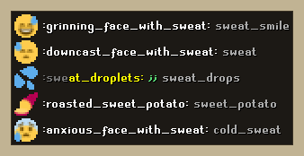
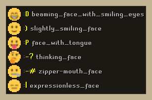
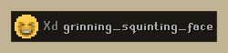
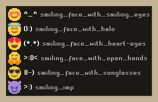

# Emoji Chat Helper

Search RuneLite's emoji as you type in Old School RuneScape chat. Start a name with a colon, like `:smil`, and a list shows the matching emoji, what's left to type, and their emoticons, like `Xd` and `<3`.

## What it does

- **Lists matches as you type.** Type a colon and part of a name, like `:smil`, and the matching emoji appear above the chatbox. The part you've typed is grey and the rest is yellow.
- **Opens on a colon.** A colon on its own lists the emoticons that start with one, like `:)`, `:D` and `:P`.
- **Emoticons too.** Typing an emoticon such as `Xd` or `<3` shows the emoji it becomes. Names that have an emoticon show it beside them in green.
- **Forgiving search.** Names match by their start, by a later word, or with a typo: `:frie` finds `:fire:`.
- **Slack and Discord names find emoji.** `:sweat_smile` finds 😅 and lists RuneLite's name for it, `:grinning_face_with_sweat:`, which is what you type. Slack names are only for searching: they never show as emoji in chat, because other players wouldn't see them.
- **Emoji in chat.** A `:name:` in public, friends, clan and private chat, and in overhead text, shows as the emoji.

The list only suggests. RuneLite doesn't allow plugins to type into the chatbox, so you type the rest yourself.

| Typing a colon | Typing an emoticon | Only emoticons |
|---|---|---|
|  |  |  |

## Who sees the emoji

The plugin only uses RuneLite's own emoji names and emoticons, the same ones RuneLite's built-in Emojis plugin shows. Anyone with that plugin on sees your `:grinning_face_with_sweat:` or `Xd` as an emoji; anyone without it sees the text you typed.

RuneLite matches names and emoticons in their exact case: `Xd` works, `XD` and `xd` don't.

## Settings

| Setting | Does |
|---|---|
| List matches while typing | Turns the list on or off |
| List position | Above the chatbox, above the chat input, or anywhere: type a colon so the list shows, then Alt+drag it |
| Matches listed | How many matches to show, 1 to 10 |
| Show emoticon names | Shows each emoticon's emoji name beside it |
| Emoji in chat | Shows `:names:` in chat and overhead text as emoji |
| Only emoticons | Only lists emoji that have an emoticon, showing the emoticon to type |

The **Style** section sets the list's font and size, emoji size, padding, row spacing, text shadow, background (lower its alpha to make it see-through), border, and text colours.

## 🤖 AI Disclosure

Portions of this project were developed with the assistance of Claude Opus 5.5 for orchestration and local Qwen 27B subagents. AI tools were primarily used for generating boilerplate code, writing unit tests, and optimising algorithms. All AI-generated code was reviewed, tested, and vetted by the human maintainers.

## Credits

Emoji pictures are [Twemoji](https://github.com/jdecked/twemoji), as RuneLite ships them. See [THIRD_PARTY_NOTICES.md](THIRD_PARTY_NOTICES.md).
